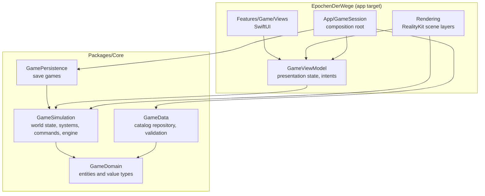
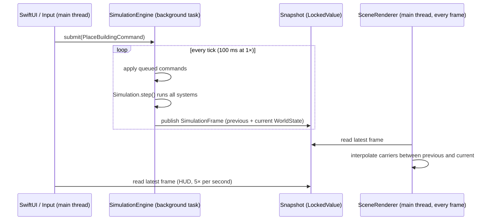

# Architecture

This document explains how the code is organised, how data flows through the game at
runtime, and why the main decisions were made. Read it before changing the structure
of the project.

## Goals

1. **Smooth frame rate.** The simulation must never block rendering.
2. **Testable rules.** Every game rule can be tested without a window or a GPU.
3. **Data-driven balancing.** Costs, cycle times and rules live in JSON, not in code.
4. **Room to grow.** Roads, vehicles, eras and AI rivals (see the milestones) can be
   added without rewriting the core.

## Layers

The project follows a clean architecture: dependencies point inwards only.

| Module | Responsibility | May import |
| --- | --- | --- |
| `GameDomain` | Entities and value types: `Building`, `Carrier`, `Terrain`, `Inventory`, `GameCatalog`, IDs | Swift standard library |
| `GameData` | Loading and validating the game catalog (`GameCatalogRepository`) | `GameDomain`, Foundation |
| `GameSimulation` | `WorldState`, simulation systems, commands, world generation, `SimulationEngine` | `GameDomain`, Synchronization |
| `GamePersistence` | Save games: `SaveGameRepository`, file format with summary header and compressed world | `GameSimulation`, Foundation |
| App: `Features` | SwiftUI views, `GameViewModel`, text formatting and localization | everything in Core, SwiftUI |
| App: `Rendering` | RealityKit scene, camera, input | everything in Core, RealityKit, AppKit |
| App: `App` | `GameApp` (composition root, saves) creates a `GameSession` (engine and view model) per game | everything |

The Core package never imports SwiftUI, AppKit or RealityKit. This is enforced by the
package manifest: none of its targets link those frameworks.

## Runtime data flow

1. **Input** is turned into intents on `GameViewModel`, which submits `GameCommand`s to
   the engine. The view model never mutates the world.
2. **The engine** runs on a detached background task with a fixed time step
   (10 ticks per second at 1×, 40 at 4×). Before each tick it applies all queued
   commands, then advances the `Simulation` by one tick.
3. **After each tick** it publishes an immutable `SimulationFrame` containing the new
   and the previous `WorldState`. `WorldState` is a value type with copy-on-write
   collections, so publishing is cheap and the copy can safely cross threads.
4. **The renderer** reads the latest frame every display frame and interpolates
   moving objects between the two states, so motion is smooth at any frame rate.
5. **The HUD** refreshes five times per second from the same snapshots.

Because the main thread only *reads* a finished snapshot, a slow tick can delay the
simulation slightly but can never drop a frame.

## Simulation

`Simulation` advances a `WorldState` by running stateless systems in a fixed order:

| Order | System | Runs | Does |
| --- | --- | --- | --- |
| 1 | `WorkforceSystem` | daily | Assigns residents to production buildings |
| 2 | `ProductionSystem` | every tick | Consumes inputs, advances cycles, produces outputs |
| 3 | `LogisticsSystem` | dispatch every 5 ticks, movement every tick | Sends carriers and moves them |
| 4 | `TransportSystem` | every tick | Drives vehicles along their lines; unloads goods wanted at a stop and loads goods wanted further down the line |
| 5 | `PopulationSystem` | every 10 days | Feeds houses, grows or shrinks them; `HouseTiers` uses up clothing and wine and moves houses up or down a tier |
| 6 | `EconomySystem` | yearly | Taxes and upkeep |
| 7 | `TradeSystem` | every 10 days | Neighbouring towns put their goods on their stop and renew what they want to buy; vehicles trade with them when they call |
| 8 | `SettlementSystem` | daily | Raises the settlement level (hamlet, village, …) when the population reaches the next threshold; levels are never lost |
| 9 | `TownGrowthSystem` | every 5 days | Builds houses, markets and workshops in their zones next to roads when their `ZoneDemand` reaches the growth threshold |

The simulation is **deterministic**: the same seed, commands and number of ticks always
produce the same world. Collections are iterated in a stable order (buildings in
placement order, goods sorted by ID) to guarantee this. Determinism makes bugs
reproducible and is a prerequisite for save games and replays.

## Design patterns

| Pattern | Where | Why |
| --- | --- | --- |
| Repository | `GameCatalogRepository`, `BundledCatalogRepository`, `JSONCatalogRepository`; `SaveGameRepository`, `FileSaveGameRepository` | The app does not care where game data and saves come from; tests and mods can supply their own |
| Command | `GameCommand`, `PlaceBuildingCommand`, `DemolishBuildingCommand`, `BuildRoadCommand`, `DemolishRoadCommand`, `ZoneCommand`, `CreateLineCommand`, `BuyVehicleCommand` | All player actions are applied in one place between ticks; easy to log, replay or network later |
| Strategy | `DeliveryPlanner`, `NearestConsumerPlanner` | How carriers pick targets can change (e.g. road routing) without touching the logistics system |
| Single point of change | `WorldState.book(_:as:year:)` and `Ledger` | Every change of the treasury goes through one method that also records it, so the finance overview can never miss a booking |
| Observer | `SimulationEvent` stream in `WorldState.events` | The simulation reports what happened as data; the UI decides how to phrase it |
| Factory | `WorldFactory`, `TerrainGenerator` | World creation (terrain, starting settlement) is separate from running a world |
| Factory + prototype | `BuildingModelFactory` | Each building model is assembled once from primitives; placed buildings are clones that share meshes and materials |
| Composite | `SceneRenderer` with `SceneLayer`s | Each visual concern (terrain, buildings, carriers, overlays) is an independent layer |
| Object pool | `CarrierLayer` | Carriers appear and disappear constantly; entities are recycled instead of reallocated |
| Singleton + flyweight | `MaterialLibrary.shared` | One shared cache of materials and meshes for all layers. It holds no game state, only rendering resources, which is why a singleton is acceptable here |
| MVVM | `GameViewModel` + SwiftUI views | Views are declarative and dumb; state and intents live in the view model |
| Design tokens | `GameTheme`, `gamePanel()`, `HUDButtonStyle`, `PanelHeader` | All HUD colours, fonts and shapes come from one place, so the look can change without touching every view |
| Composition root | `GameApp` | The only place that creates concrete implementations; everything else gets dependencies injected. Loading a game replaces the whole `GameSession`, so nothing of the old game leaks into the new one |

Singletons are deliberately rare. Anything with game state is injected so it can be
replaced in tests.

## Concurrency

- Swift 6 language mode with complete concurrency checking in all targets.
- The app target uses `MainActor` as its default isolation (Xcode 26): UI and rendering
  code is main-thread code unless stated otherwise.
- Core types are value types and `Sendable`.
- Shared mutable state between the engine and the main thread is limited to three
  `LockedValue`s (a `Mutex` from the Synchronization framework): the latest frame, the
  command queue and the speed setting. Critical sections are a single copy or append.

## Performance

| Technique | Where |
| --- | --- |
| Simulation off the main thread, fixed time step | `SimulationEngine` |
| Interpolation between ticks | `CarrierLayer` |
| Terrain in 32 × 32-cell tiles with five detail levels by camera distance (half a cell to eight cells per vertex), skirts against seams, a few tiles rebuilt per frame | `TerrainLayer` |
| Ground texture (2–4k pixels, about 2 m per pixel) painted on a background task (`@concurrent`), plain colour until ready | `TerrainTextureBuilder` |
| Vegetation merged into one mesh per tile, only within 900 m of the camera; only touched tiles rebuild | `TerrainLayer` |
| Shared materials and meshes | `MaterialLibrary` |
| Entity pooling | `CarrierLayer` |
| Building models cloned from per-type templates | `BuildingModelFactory` |
| Animation time advances with game speed; only working buildings animate | `BuildingLayer` |
| Diff-based updates; markers change material only on status change | `BuildingLayer` |
| Placement preview ray cast only when mouse, tool or world changes | `SceneCoordinator` |
| HUD refreshed 5× per second, not every frame; observation only fires on change | `GameViewModel` |

## Decisions

### Game interface

The HUD is a layer of SwiftUI views over the 3D scene. Which floating panels are
open, and in which order, is presentation state in `GameViewModel.openPanels`;
their positions are view state in `GameScreen`. The mini map paints its terrain
once with `TerrainTextureBuilder` on a background task and draws roads, buildings
and the camera with a `Canvas`. The scene reports the camera to the view model
through `reportCamera(_:)`, which only publishes noticeable changes, so the mini map
does not redraw every frame.

### ARView instead of RealityView

`RealityView` is Apple's modern SwiftUI entry point to RealityKit. The game needs
right-button dragging, scroll-wheel zoom, hover tracking and screen-to-ground ray casts
with a custom camera. `ARView` (in non-AR mode on macOS) provides `ray(through:)` and
plain `NSView` event handling for all of these today. The rendering code is isolated
behind `SceneView`, so switching to `RealityView` later only touches that file and the
coordinator.

### Save file format

A save is one file: a magic number with format version, a small JSON summary (name,
date, year, population, treasury) and the `WorldState` as a binary property list,
compressed with LZFSE. The save list reads only the summaries. `WorldState` is
`Codable`; lookup tables are rebuilt on load, and biomes and deposits are stored
run-length encoded. A restored game continues exactly like the original, which the
tests check by running both side by side.

### Value-type world state

The world is a struct, not a graph of objects. This makes snapshots trivial (copy the
struct), removes data races by construction, and keeps the simulation deterministic.
The cost is that systems mutate buildings by index rather than by reference, which is
an acceptable trade-off.

### Events as data

The simulation emits `SimulationEvent` values instead of strings. Text is created in
`GameText` and localized through `Localizable.xcstrings`, so the Core package stays
free of presentation concerns and the game can be translated without touching rules.

### Zone demand is the growth rule

`ZoneDemand` turns the growth rules into a value from 0 to 1 per zone kind, with a
reason and a flag for missing space. `TownGrowthSystem` builds when the value
reaches 0.5, and the HUD shows the same values as demand bars. Because both read
one function, the bars can never promise growth the town will not deliver.

### The region is placed around the start

`RegionPlanner` runs once when a world is created. It puts stone deposits and vine
slopes 22–45 cells from the start and neighbouring towns 34–60 cells away, all beyond
the carriers' 150 m. Towns are data (`TownTemplate` in the catalog) plus one real
stop building owned by the town (`Building.townID`), so lines, routing and
vehicles need no special cases except at the moment of trade.

### Hybrid logistics: carriers locally, lines for distance

Carriers handle the neighbourhood (150 m) and walk in straight lines. Everything
further is the player's job: stops collect goods that one of their lines takes to a
stop where a consumer needs them (`StopDemand`), and vehicles find their way on the
road network with A* (`RoadNetwork`). Storehouses do not count as demand for lines,
so goods never shuttle between storehouses.
