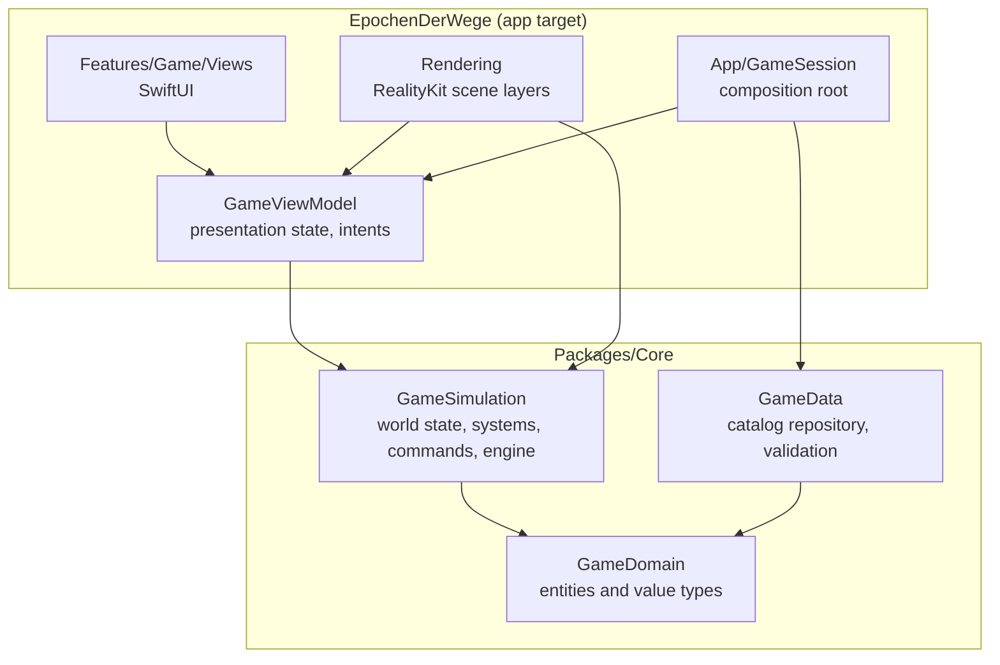
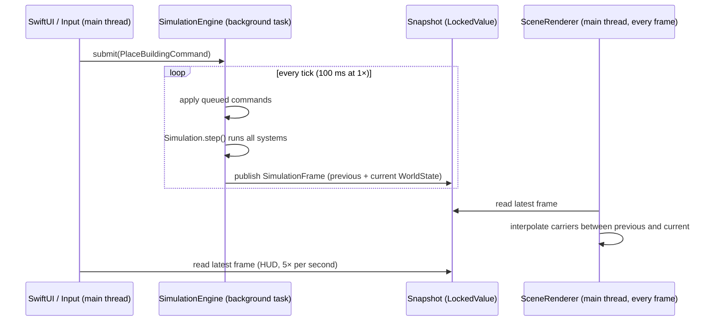

# Architecture

This document explains how the code is organised, how data flows through the game at
runtime, and why the main decisions were made. Read it before changing the structure
of the project.

## Goals

1. **Smooth frame rate.** The simulation must never block rendering.
2. **Testable rules.** Every game rule can be tested without a window or a GPU.
3. **Data-driven balancing.** Costs, cycle times and rules live in JSON, not in code.
4. **Room to grow.** Roads, vehicles, eras and AI rivals (see the milestones) can be
   added without rewriting the core.

## Layers

The project follows a clean architecture: dependencies point inwards only.

| Module | Responsibility | May import |
| --- | --- | --- |
| `GameDomain` | Entities and value types: `Building`, `Carrier`, `Terrain`, `Inventory`, `GameCatalog`, IDs | Swift standard library |
| `GameData` | Loading and validating the game catalog (`GameCatalogRepository`) | `GameDomain`, Foundation |
| `GameSimulation` | `WorldState`, simulation systems, commands, world generation, `SimulationEngine` | `GameDomain`, Synchronization |
| App: `Features` | SwiftUI views, `GameViewModel`, text formatting and localization | everything in Core, SwiftUI |
| App: `Rendering` | RealityKit scene, camera, input | everything in Core, RealityKit, AppKit |
| App: `App` | `GameSession` wires concrete implementations together | everything |

The Core package never imports SwiftUI, AppKit or RealityKit. This is enforced by the
package manifest: none of its targets link those frameworks.

## Runtime data flow

1. **Input** is turned into intents on `GameViewModel`, which submits `GameCommand`s to
   the engine. The view model never mutates the world.
2. **The engine** runs on a detached background task with a fixed time step
   (10 ticks per second at 1×, 40 at 4×). Before each tick it applies all queued
   commands, then advances the `Simulation` by one tick.
3. **After each tick** it publishes an immutable `SimulationFrame` containing the new
   and the previous `WorldState`. `WorldState` is a value type with copy-on-write
   collections, so publishing is cheap and the copy can safely cross threads.
4. **The renderer** reads the latest frame every display frame and interpolates
   moving objects between the two states, so motion is smooth at any frame rate.
5. **The HUD** refreshes five times per second from the same snapshots.

Because the main thread only *reads* a finished snapshot, a slow tick can delay the
simulation slightly but can never drop a frame.

## Simulation

`Simulation` advances a `WorldState` by running stateless systems in a fixed order:

| Order | System | Runs | Does |
| --- | --- | --- | --- |
| 1 | `WorkforceSystem` | daily | Assigns residents to production buildings |
| 2 | `ProductionSystem` | every tick | Consumes inputs, advances cycles, produces outputs |
| 3 | `LogisticsSystem` | dispatch every 5 ticks, movement every tick | Sends carriers and moves them |
| 4 | `PopulationSystem` | every 10 days | Feeds houses, grows or shrinks them |
| 5 | `EconomySystem` | yearly | Taxes and upkeep |
| 6 | `TownGrowthSystem` | every 5 days | Builds houses in residential zones next to roads when the town has demand |

The simulation is **deterministic**: the same seed, commands and number of ticks always
produce the same world. Collections are iterated in a stable order (buildings in
placement order, goods sorted by ID) to guarantee this. Determinism makes bugs
reproducible and is a prerequisite for save games and replays.

## Design patterns

| Pattern | Where | Why |
| --- | --- | --- |
| Repository | `GameCatalogRepository`, `BundledCatalogRepository`, `JSONCatalogRepository` | The app does not care where game data comes from; tests and mods can supply their own |
| Command | `GameCommand`, `PlaceBuildingCommand`, `DemolishBuildingCommand`, `BuildRoadCommand`, `DemolishRoadCommand`, `ZoneCommand` | All player actions are applied in one place between ticks; easy to log, replay or network later |
| Strategy | `DeliveryPlanner`, `NearestConsumerPlanner` | How carriers pick targets can change (e.g. road routing) without touching the logistics system |
| Single point of change | `WorldState.book(_:as:year:)` and `Ledger` | Every change of the treasury goes through one method that also records it, so the finance overview can never miss a booking |
| Observer | `SimulationEvent` stream in `WorldState.events` | The simulation reports what happened as data; the UI decides how to phrase it |
| Factory | `WorldFactory`, `TerrainGenerator` | World creation (terrain, starting settlement) is separate from running a world |
| Factory + prototype | `BuildingModelFactory` | Each building model is assembled once from primitives; placed buildings are clones that share meshes and materials |
| Composite | `SceneRenderer` with `SceneLayer`s | Each visual concern (terrain, buildings, carriers, overlays) is an independent layer |
| Object pool | `CarrierLayer` | Carriers appear and disappear constantly; entities are recycled instead of reallocated |
| Singleton + flyweight | `MaterialLibrary.shared` | One shared cache of materials and meshes for all layers. It holds no game state, only rendering resources, which is why a singleton is acceptable here |
| MVVM | `GameViewModel` + SwiftUI views | Views are declarative and dumb; state and intents live in the view model |
| Composition root | `GameSession` | The only place that creates concrete implementations; everything else gets dependencies injected |

Singletons are deliberately rare. Anything with game state is injected so it can be
replaced in tests.

## Concurrency

- Swift 6 language mode with complete concurrency checking in all targets.
- The app target uses `MainActor` as its default isolation (Xcode 26): UI and rendering
  code is main-thread code unless stated otherwise.
- Core types are value types and `Sendable`.
- Shared mutable state between the engine and the main thread is limited to three
  `LockedValue`s (a `Mutex` from the Synchronization framework): the latest frame, the
  command queue and the speed setting. Critical sections are a single copy or append.

## Performance

| Technique | Where |
| --- | --- |
| Simulation off the main thread, fixed time step | `SimulationEngine` |
| Interpolation between ticks | `CarrierLayer` |
| Terrain built once, flat-shaded, one mesh | `TerrainLayer` |
| Trees merged into one mesh per 16 × 16 chunk; only touched chunks rebuild | `TerrainLayer` |
| Shared materials and meshes | `MaterialLibrary` |
| Entity pooling | `CarrierLayer` |
| Building models cloned from per-type templates | `BuildingModelFactory` |
| Animation time advances with game speed; only working buildings animate | `BuildingLayer` |
| Diff-based updates; markers change material only on status change | `BuildingLayer` |
| Placement preview ray cast only when mouse, tool or world changes | `SceneCoordinator` |
| HUD refreshed 5× per second, not every frame; observation only fires on change | `GameViewModel` |

## Decisions

### ARView instead of RealityView

`RealityView` is Apple's modern SwiftUI entry point to RealityKit. The game needs
right-button dragging, scroll-wheel zoom, hover tracking and screen-to-ground ray casts
with a custom camera. `ARView` (in non-AR mode on macOS) provides `ray(through:)` and
plain `NSView` event handling for all of these today. The rendering code is isolated
behind `SceneView`, so switching to `RealityView` later only touches that file and the
coordinator.

### Value-type world state

The world is a struct, not a graph of objects. This makes snapshots trivial (copy the
struct), removes data races by construction, and keeps the simulation deterministic.
The cost is that systems mutate buildings by index rather than by reference, which is
an acceptable trade-off.

### Events as data

The simulation emits `SimulationEvent` values instead of strings. Text is created in
`GameText` and localized through `Localizable.xcstrings`, so the Core package stays
free of presentation concerns and the game can be translated without touching rules.

### Straight-line carriers in the prototype

Carriers currently walk in straight lines within a fixed range. Roads and A* routing
are planned in milestone 0.2 and will plug in as a new `DeliveryPlanner` plus a
movement component; the rest of the logistics system stays as it is.
