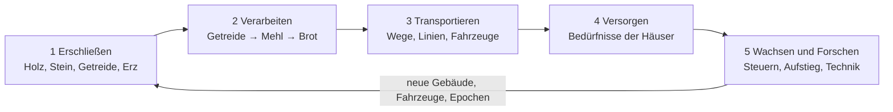

# Epochen der Wege – Game Design Document

Stand: 3. November 2026

## Vision & Eckdaten

Ein friedliches 3D-Aufbau- und Logistikspiel: Du führst ein Volk von der Antike in die Moderne, und Wachstum entsteht nur, wenn Waren und Menschen physisch transportiert werden.

| Eckdatum | Festlegung |
| --- | --- |
| Plattform | macOS, Swift, Xcode |
| Darstellung | 3D, frei drehbare Kamera, Stil zwischen Modellbahn und Strategiekarte |
| Zeitmodell | Echtzeit mit Pause und Zeitraffer (1×, 2×, 4×) |
| Konflikt | Kein Militär, kein Krieg; Konkurrenz nur wirtschaftlich |
| Karte | Eine Region, ca. 16 × 16 km, 3 bis 6 Städte und Dörfer |
| Startepoche | Antike, Ende in der Moderne |
| Bewohner | Mittelweg: Simulation in Gruppen pro Haus, sichtbare Figuren nur als Darstellung |

**Design-Säulen** – jede Entscheidung wird an diesen drei gemessen:

1. **Alles fließt sichtbar.** Jede Ware, jeder Pendler ist ein Objekt auf einem Weg. Kein unsichtbares Lager.
2. **Logistik ist das Rätsel.** Die Herausforderung ist nicht, was ich baue, sondern wie ich es verbinde.
3. **Epochen schichten sich.** Alte Wege bleiben, werden ausgebaut oder ersetzt; die Landschaft erzählt die Geschichte des Spiels.

## Kern-Kreislauf & Spielablauf

Der Spieler durchläuft immer wieder denselben Kreislauf; jede Runde wird größer, weil neue Epochen längere Ketten und weitere Wege bringen.

Transport ist das Nadelöhr: Ohne Verbindung erreichen Waren weder Weiterverarbeitung noch Häuser.

**Spielverlauf**

1. **Start (Jahr 0–10):** Ein Dorf mit 20 Bauern, ein Lager, 10.000 Taler. Erste Ketten mit Trägern und Trampelpfaden.
2. **Frühe Phase:** Straßen und Ochsenkarren verbinden Dorf und Rohstoffe; erste Bürger, erste neutrale Stadt angebunden.
3. **Mittlere Phase:** Mehrere Städte, Flüsse und Kanäle als Güterachsen, Epochenwechsel ins Mittelalter und in die Industrie.
4. **Späte Phase:** Bahn- und Straßennetz über die ganze Region, Modernisierung alter Wege, Wettlauf um Weltwunder.

**Zeitmodell**

- Simulation läuft in festen Ticks: 10 Ticks pro Sekunde bei 1×
- 1 Spieltag = 2 Sekunden bei 1×; 1 Spieljahr = 60 Spieltage (2 Minuten)
- Zeitraffer 2× und 4× verkürzt nur die Wartezeit zwischen Ticks; die Regeln bleiben gleich
- Pause erlaubt Bauen und Planen ohne Zeitdruck
- Eine Partie bis zur Moderne dauert ca. 220 Spieljahre, also rund 7 bis 8 Stunden bei 1×

## Welt & Karte

Die Karte ist ein prozedural erzeugtes Höhenfeld mit Flüssen und Küste; das Gelände bestimmt, wo sich Bauen lohnt und wie teuer Wege werden.

**Aufbau**

- Höhenfeld mit 4-m-Raster (ca. 4.000 × 4.000 Punkte), in Kacheln von 256 × 256 für Darstellung und Detailstufen
- Biome: Ebene, Wald, Hügelland, Gebirge, Feuchtgebiet, Küste, Fluss
- Ein Seed erzeugt die Karte; derselbe Seed ergibt dieselbe Welt (wichtig für Szenarien und Tests)

**Ressourcen**

| Ressource | Vorkommen | Art | Regeneration |
| --- | --- | --- | --- |
| Holz | Wald | erneuerbar | Wald wächst nach, 1 Baum pro 10 Spieltage, wenn Förster vorhanden |
| Getreide, Flachs, Weintrauben | Ebene, Feld | erneuerbar | Ernte pro Jahreszeit |
| Fisch | Küste, Fluss | erneuerbar | Bestand erholt sich, Überfischung möglich |
| Lehm, Stein | Hügel, Flussäufer | endlich, sehr groß | keine |
| Erz, Kohle | Gebirge | endlich | keine; Vorkommen von 20.000 bis 200.000 t |
| Öl | späte Epoche, versteckt | endlich | keine; erst nach Forschung sichtbar |

**Gelände-Regeln**

- Bauen auf Hang über 15 % kostet doppelt; Gelände kann gegen Geld angeglichen werden
- Steigung bremst Fahrzeuge je nach Zugkraft: Karren ab 6 %, Dampfloks ab 2,5 %, LKW ab 8 %
- Brücken und Tunnel kosten das 5- bis 15-Fache eines normalen Wegstücks und brauchen eine passende Forschung
- Flüsse sind natürliche Wasserwege: schiffbar ab einer Mindestbreite, Kanäle ab dem Mittelalter baubar

## Bevölkerung & Siedlungen

Bewohner werden pro Haus als Gruppe gerechnet; sie wachsen und steigen auf, wenn ihre Bedürfnisse in Reichweite erfüllt sind, und schrumpfen, wenn nicht.

**Berufsstände und Bedürfnisse** (jede Stufe braucht zusätzlich die Waren der Stufe davor)

| Stand | Ab Epoche | Bewohner pro Haus | Bedürfnisse | Leistet |
| --- | --- | --- | --- | --- |
| Bauern | Antike | 4 | Nahrung (Brot oder Fisch), Wasser | Arbeit in Rohstoff-Betrieben |
| Bürger | Antike | 6 | + Kleidung, Wein, Markt in Reichweite | Handwerk, Steuern |
| Handwerker | Mittelalter | 8 | + Werkzeuge, Möbel, Kirche oder Tempel | Werkstätten, Forschung (gering) |
| Arbeiter | Industrie | 12 | + Kohle zum Heizen, Fleisch, öffentlicher Verkehr | Fabriken |
| Ingenieure | Industrie | 10 | + Bildung, Zeitung, Konsumgüter | Forschung, Verwaltung |
| Angestellte | Moderne | 14 | + Elektrik, Autos oder ÖPNV, Freizeit | Dienstleistung, hohe Steuern |

**Versorgungsregel**

- Jedes Haus prüft alle 10 Spieltage seine Versorgung: Anteil der erfüllten Bedürfnisse in 0 bis 100 %
- Unter 50 %: Haus verliert Bewohner; 50 bis 90 %: stabil; über 90 % für 2 Spieljahre: Aufstieg zum nächsten Stand, wenn freigeschaltet
- Waren gelten als „in Reichweite“, wenn ein Markt, Laden oder Bahnhof sie auf Lager hat und das Haus in dessen Radius liegt (Markt 300 m, Laden 200 m)

**Pendeln**

- Jeder Betrieb braucht Arbeitskräfte eines bestimmten Standes
- Arbeiter gehen zu Fuß bis 1,5 km; weiter nur mit Personenverkehr
- Ein Betrieb mit 50 % der Arbeiter produziert mit 50 % Leistung

**Darstellung (Mittelweg)**

- Gerechnet wird pro Haus und pro Linie als Zahl; sichtbare Figuren laufen als Stichprobe (ca. 1 Figur pro 10 Pendler)
- Ein Klick auf ein Haus zeigt die Bewohner, ihre Arbeitsstelle und welche Bedürfnisse fehlen

**Städte**

- Die Karte startet mit 3 bis 6 neutralen Siedlungen (200 bis 1.500 Einwohner) und deinem Start-Dorf
- Neutrale Städte wachsen von selbst, wenn du sie versorgst und anbindest; sie werden so zu Kunden und Arbeitskräfte-Quellen
- Häuser baut die Stadt selbst innerhalb ausgewiesener Wohnzonen; du baust Betriebe, Wege und Versorgungsgebäude

## Produktion & Waren

Jeder Betrieb wandelt Eingangswaren in einem festen Zyklus in Ausgangswaren um; Ketten werden pro Epoche länger, und alle Werte stehen in JSON-Dateien, damit wir sie ohne Code-Änderung ausbalancieren können.

**Regeln für Betriebe**

- Ein Betrieb hat Eingangslager, Ausgangslager (je 20 Einheiten), Arbeiterbedarf und Zykluszeit
- Volles Ausgangslager = Stillstand. Leeres Eingangslager = Stillstand
- Waren verlassen den Betrieb nur über eine angebundene Haltestelle oder einen Weg zu einem Lager
- Lagerhäuser (200 Einheiten) puffern Waren und dienen als Umschlagpunkt zwischen Verkehrsmitteln

**Produktionsketten (Startwerte, Zyklus in Spieltagen)**

| Epoche | Betrieb | Eingang | Ausgang | Zyklus | Arbeiter |
| --- | --- | --- | --- | --- | --- |
| Antike | Holzfäller | – | 1 Holz | 2 | 4 Bauern |
| Antike | Steinbruch | – | 1 Stein | 3 | 6 Bauern |
| Antike | Getreidehof | – | 2 Getreide | 4 | 6 Bauern |
| Antike | Mühle | 2 Getreide | 2 Mehl | 2 | 2 Bauern |
| Antike | Bäckerei | 2 Mehl | 3 Brot | 2 | 3 Bürger |
| Antike | Fischer | – | 2 Fisch | 3 | 3 Bauern |
| Antike | Schaffarm + Weberei | Wolle | 1 Kleidung | 4 | 4 Bauern, 3 Bürger |
| Antike | Weingut | – | 1 Wein | 6 | 5 Bauern |
| Mittelalter | Erzmine + Köhlerei | Holz | Erz, Holzkohle | 3 | 8 Bauern |
| Mittelalter | Schmelze | 2 Erz, 1 Holzkohle | 1 Eisen | 3 | 4 Handwerker |
| Mittelalter | Schmiede | 1 Eisen, 1 Holz | 2 Werkzeuge | 3 | 3 Handwerker |
| Mittelalter | Schreinerei | 2 Holz | 1 Möbel | 3 | 3 Handwerker |
| Industrie | Kohlemine | – | 3 Kohle | 2 | 12 Arbeiter |
| Industrie | Stahlwerk | 2 Erz, 2 Kohle | 2 Stahl | 2 | 20 Arbeiter |
| Industrie | Maschinenfabrik | 2 Stahl, 1 Werkzeuge | 1 Maschinen | 4 | 20 Arbeiter, 4 Ingenieure |
| Industrie | Schlachthof | 2 Vieh | 3 Fleisch | 2 | 8 Arbeiter |
| Moderne | Raffinerie | 3 Öl | 2 Treibstoff, 1 Kunststoff | 2 | 15 Arbeiter |
| Moderne | Kraftwerk | 2 Kohle oder Treibstoff | Strom im Netz | 1 | 10 Arbeiter |
| Moderne | Konsumgüterfabrik | 1 Kunststoff, 1 Stahl | 2 Konsumgüter | 3 | 25 Angestellte |

**Verderbliche Waren**

- Fisch, Fleisch, Milch und Brot haben eine Haltbarkeit (Fisch 5, Fleisch 8, Brot 10 Spieltage)
- Abgelaufene Waren verschwinden aus Lagern und Fahrzeugen
- Damit lohnen sich schnelle Verkehrsmittel und kurze Wege auch dann, wenn langsame billiger sind

**Baumaterial**

- Gebäude kosten Geld und Baumaterial (Holz, Stein, später Ziegel, Stahl, Beton)
- Das Material muss zur Baustelle transportiert werden; die Baustelle ist ein normales Ziel im Logistiknetz

## Transport & Logistik

Du baust Wege und richtest Linien ein; Fahrzeuge fahren Linien ab, laden an Haltestellen und erzeugen Einnahmen pro transportierter Einheit und Kilometer.

**Netze**

| Netz | Ab Epoche | Baukosten pro km | Besonderheit |
| --- | --- | --- | --- |
| Trampelpfad | Antike | 0 (entsteht durch Nutzung) | nur Träger, langsam |
| Straße (Schotter) | Antike | 2.000 | Karren und Wagen |
| Pflasterstraße | Mittelalter | 6.000 | +30 % Tempo, weniger Verschleiß |
| Wasserweg (Fluss, Kanal) | Antike / Mittelalter | Kanal 25.000 | große Mengen, langsam |
| Eisenbahn | Industrie | 40.000 | Steigung kritisch, sehr hohe Kapazität |
| Asphaltstraße | Moderne | 15.000 | LKW, Busse, Autos |
| Elektrifizierte Bahn | Moderne | +20.000 auf Bahn | schnellere, stärkere Loks |

**Fahrzeuge (Startwerte)**

| Fahrzeug | Epoche | Kapazität | Tempo km/h | Kaufpreis | Unterhalt pro Jahr | Lebensdauer Jahre |
| --- | --- | --- | --- | --- | --- | --- |
| Träger | Antike | 1 | 4 | 50 | 20 | 20 |
| Ochsenkarren | Antike | 4 | 5 | 400 | 80 | 20 |
| Flusskahn | Antike | 20 | 6 | 1.500 | 200 | 30 |
| Pferdewagen | Mittelalter | 8 | 10 | 1.200 | 200 | 20 |
| Postkutsche | Mittelalter | 8 Personen | 12 | 1.500 | 250 | 20 |
| Segelschiff | Mittelalter | 60 | 10 | 8.000 | 800 | 35 |
| Dampflok + Güterwagen | Industrie | 30 pro Wagen | 40 | 30.000 | 3.000 | 30 |
| Pferdestraßenbahn | Industrie | 30 Personen | 12 | 5.000 | 600 | 25 |
| LKW | Moderne | 15 | 60 | 20.000 | 2.500 | 15 |
| Bus | Moderne | 50 Personen | 60 | 25.000 | 3.000 | 15 |
| E-Lok + Güterwagen | Moderne | 50 pro Wagen | 100 | 120.000 | 8.000 | 35 |

**Linien**

- Eine Linie ist eine geordnete Liste von Haltestellen plus zugewiesene Fahrzeuge
- Pro Halt einstellbar: einladen, ausladen, warten bis voll (mit Höchstwartezeit)
- Fahrzeuge nehmen nur Waren mit, deren Ziel auf der Linie liegt oder über eine Umsteigekette erreichbar ist
- Personen und Waren wählen ihre Route nach Reisezeit; zu volle Linien verlieren Fahrgäste an die nächstbeste Route

**Haltestellen**

- Marktplatz/Ablage (Antike), Hafen, Bahnhof, Bushaltestelle, Logistikhof
- Einzugsradius für Waren und Personen; ein Bahnhof mit 4 Gleisen bedient deutlich mehr Fahrzeuge als einer mit 2
- Haltestellen haben Kapazität; überfüllte Halte bilden Warteschlangen, die man sieht

**Alterung**

- Ab 75 % der Lebensdauer steigt der Unterhalt um 50 % und Fahrzeuge fallen öfter kurz aus
- Ersetzen per Knopf: das alte Fahrzeug wird zum Restwert verkauft, ein Nachfolgemodell übernimmt die Linie

## Epochen & Forschung

Vier Epochen, jede wird durch Forschung und eine Bevölkerungsschwelle freigeschaltet; ein Epochenwechsel erweitert alles auf einmal, alte Technik bleibt aber nutzbar.

| Epoche | Spieljahre (Richtwert) | Wechsel-Bedingung | Neu freigeschaltet |
| --- | --- | --- | --- |
| Antike | 0–60 | Start | Träger, Karren, Kahn, Grundketten, Bauern und Bürger |
| Mittelalter | 60–140 | 300 Bürger + 4 Schlüsseltechnologien | Eisen, Werkzeuge, Pflaster, Kanäle, Segelschiffe, Handwerker |
| Industrie | 140–220 | 500 Handwerker + Dampfmaschine erforscht | Eisenbahn, Kohle, Stahl, Fabriken, Arbeiter, Ingenieure |
| Moderne | 220+ | 400 Ingenieure + Elektrizität erforscht | Strom, Öl, LKW, Bus, E-Lok, Angestellte |

**Forschungspunkte**

- Bürger: 0,1 Punkte pro Kopf und Jahr; Handwerker 0,3; Ingenieure 1,0; Angestellte 0,6
- Gebäude verstärken: Bibliothek +20 %, Kloster +30 % (Mittelalter), Universität +50 % (Industrie)
- Eine Technologie kostet zwischen 50 (frühe Antike) und 5.000 Punkten (späte Moderne)

**Technologiebaum (Ausschnitt)**

- Antike: Rad → Ochsenkarren → Schotterstraße; Bootsbau → Flusskahn; Weberei → Kleidung; Schrift → Bibliothek
- Mittelalter: Metallurgie → Schmiede → Werkzeuge; Pflasterbau; Wasserbau → Kanal → Schleuse; Kompass → Segelschiff
- Industrie: Dampfmaschine → Eisenbahn → Brückenbau → Tunnelbau; Hochofen → Stahl; Mechanik → Maschinen
- Moderne: Elektrizität → Kraftwerk → E-Lok; Verbrennungsmotor → LKW, Bus; Petrochemie → Raffinerie

**Infrastruktur-Upgrade**

- Vorhandene Wege können ohne Abriss ausgebaut werden (Schotter → Pflaster → Asphalt), Kosten = Differenz plus 20 %
- Fahrzeuge alter Epochen bleiben fahrbar, verlieren aber gegenüber neuen deutlich an Wirtschaftlichkeit

## Wirtschaft & Finanzen

Eine Währung (Taler) für alles; Geld kommt aus Steuern, Transport und Handel, Geld geht an Bau, Unterhalt und Fahrzeuge.

**Einnahmen**

- Steuern pro Einwohner und Jahr: Bauer 1, Bürger 3, Handwerker 6, Arbeiter 8, Ingenieur 15, Angestellter 20 Taler; nur bei Versorgung über 50 %
- Transporteinnahmen: Grundpreis der Ware × Entfernung × Tempo-Bonus (schneller als erwartet = bis +50 %)
- Handel: Überschüsse an Handelsposten am Kartenrand oder an andere Völker verkaufen

**Ausgaben**

- Bau: Geld plus Material (siehe Produktion)
- Unterhalt: Gebäude, Wege und Fahrzeuge pro Jahr
- Kauf von Fahrzeugen

**Warenpreise (Grundwerte pro Einheit)**

| Ware | Preis | Ware | Preis |
| --- | --- | --- | --- |
| Holz, Stein, Getreide | 2 | Werkzeuge, Möbel | 15 |
| Mehl, Fisch, Wolle | 4 | Kohle, Erz | 5 |
| Brot, Kleidung | 8 | Stahl | 20 |
| Wein | 10 | Maschinen | 60 |
| Eisen | 12 | Konsumgüter | 40 |

**Startkapital und Kredite**

- Start: 10.000 Taler (normal), 25.000 (leicht), 5.000 (schwer)
- Kredite in Schritten von 5.000 Taler, Zins 5 % pro Jahr, Rückzahlung jederzeit
- Bankrott, wenn der Kontostand 2 Jahre unter dem Kreditlimit liegt (nur im Wettbewerbsmodus)

## Andere Völker & Territorium

1 bis 3 KI-Völker teilen sich die Region mit dir; sie konkurrieren um Ressourcen, Städte und Handel, aber nie mit Waffen.

**Einflussgebiet**

- Jedes Volk hat ein Einflussgebiet um seine Gebäude und versorgten Häuser
- Einfluss wächst durch Versorgung und Anbindung: Eine neutrale Stadt, die du zu mehr als 60 % versorgst, schließt sich dir an
- Bauen ist nur im eigenen oder neutralen Gebiet erlaubt; Wege dürfen fremdes Gebiet gegen eine Durchfahrtsgebühr queren

**Wettbewerb**

- Zwei Völker können dieselbe neutrale Stadt beliefern; wer besser versorgt, gewinnt ihren Einfluss
- Ressourcenvorkommen gehören dem, in dessen Gebiet sie liegen

**Diplomatie und Handel**

- Handelsvertrag: feste Warenmenge pro Jahr zu festem Preis
- Wegerecht: kostenlose Durchfahrt durch fremdes Gebiet
- Gemeinschaftsprojekt: Brücke, Kanal oder Bahnstrecke, Kosten geteilt, beide dürfen nutzen
- Beziehungswert -100 bis +100; er steigt durch erfüllte Verträge und sinkt durch Abwerben von Städten

**KI-Charaktere**

- Händler (handelt viel, baut weniger), Baumeister (große Netze, wenig Diplomatie), Gelehrter (schnelle Forschung)

## Ziele & Spielmodi

Drei Modi teilen dieselben Regeln und unterscheiden sich nur in Zielen und Gegnern.

| Modus | Gegner | Ziel | Ende |
| --- | --- | --- | --- |
| Freies Spiel | optional 0–3 KI | keins; Meilensteine als Belohnung | nie |
| Szenario | vorgegeben | feste Aufgabe, z. B. „Versorge 3 Städte mit Brot bis Jahr 40“ | Aufgabe erfüllt oder Frist verpasst |
| Wettbewerb | 1–3 KI | als Erster ein Weltwunder fertigstellen oder bei Spielende den höchsten Wohlstand haben | Wunder fertig oder Jahr 300 |

**Weltwunder** (je Epoche eins, jedes braucht große Mengen bestimmter Waren auf einer Baustelle)

- Antike: Leuchtturm – 5.000 Stein, 2.000 Holz
- Mittelalter: Kathedrale – 8.000 Stein, 2.000 Werkzeuge, 1.000 Wein
- Industrie: Weltausstellung – 3.000 Stahl, 1.000 Maschinen
- Moderne: Großer Hauptbahnhof – 5.000 Stahl, 3.000 Konsumgüter, Bahnanbindung zu allen Städten

**Wohlstand** = Einwohner × Durchschnittsstand + Wert des Verkehrsnetzes + Kontostand / 100

## Offene Fragen & nächste Schritte

Der erste Prototyp deckt nur die Antike ab: Karte, ein Dorf, drei Ketten, Straßen und Karren. Er soll zeigen, ob der Kern-Kreislauf Spaß macht, bevor wir in die Breite gehen.

**Offene Fragen**

- [ ] Grafikstil: Low-Poly mit klaren Farben (schneller machbar) oder eher realistisch?
- [ ] Technik: RealityKit (schneller Start) oder eigene Metal-Engine (mehr Kontrolle bei großen Karten)? Vorschlag: RealityKit für den Prototyp, Simulation so trennen, dass ein Wechsel möglich bleibt
- [ ] Jahreszeiten mit Auswirkung auf Ernte und Schifffahrt (zugefrorene Flüsse)?
- [ ] Endlos-Spiel: was passiert nach der Moderne?
- [ ] Name des Spiels

**Prototyp-Umfang (Meilenstein 1)**

1. Xcode-Projekt, 3D-Szene, Kamera (drehen, zoomen, verschieben)
2. Terrain aus Seed erzeugen, Wald und Felder platzieren
3. Gebäude setzen: Holzfäller, Getreidehof, Mühle, Bäckerei, Lager, Haus
4. Simulation: Tick-Schleife, Produktion, Bedürfnisse, Wachstum
5. Straßen bauen, Wegfindung, Ochsenkarren auf Linien
6. Einfache Oberfläche: Baumenü, Geld, Warenanzeige, Pause und Zeitraffer

**Architektur-Grundsatz**

- Simulation als eigenes Swift-Paket ohne Grafik-Abhängigkeit, testbar mit Unit-Tests
- Spielwerte (Ketten, Fahrzeuge, Preise) in JSON-Dateien
- Darstellung liest nur den Simulationszustand und schickt Befehle zurück
