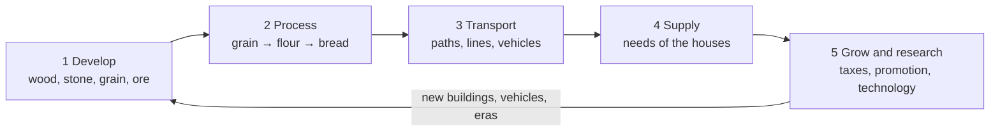

# Epochen der Wege – Game Design Document

## Vision and key facts

A peaceful 3D city-building and logistics game: you lead a people from antiquity to the
modern age, and growth only happens when goods and people are physically transported.

| Aspect | Decision |
| --- | --- |
| Platform | macOS, Swift, Xcode |
| Presentation | 3D, freely rotating camera, look between model railway and strategy map |
| Time | Real time with pause and fast-forward (1×, 2×, 4×) |
| Conflict | No military, no war; competition is economic only |
| Map | One region of about 16 × 16 km with 3 to 6 towns and villages |
| Starting era | Antiquity, ending in the modern age |
| Residents | Middle ground: simulated in groups per house, visible figures are for show only |

**Design pillars** – every decision is measured against these three:

1. **Everything flows visibly.** Every good and every commuter is an object on a path. No invisible storage.
2. **Logistics is the puzzle.** The challenge is not *what* to build but *how to connect* it.
3. **Eras build on each other.** Old paths remain, get upgraded or replaced; the landscape tells the story of the game.

## Core loop and progression

The player runs through the same loop again and again; each round grows because new eras bring longer chains and wider networks.

Transport is the bottleneck: without a connection, goods reach neither the next production step nor the houses.

**Progression**

1. **Start (years 0–10):** a village with 20 farmers, a storehouse and 10,000 thalers. First chains with carriers on footpaths.
2. **Early game:** roads and ox carts connect the village to resources; first citizens, first neutral town connected.
3. **Mid game:** several towns, rivers and canals as freight axes, transition to the Middle Ages and the industrial age.
4. **Late game:** rail and road network across the whole region, modernising old routes, race for wonders.

**Time model**

- The simulation runs in fixed ticks: 10 ticks per second at 1×
- 1 day = 2 seconds at 1×; 1 year = 60 days (2 minutes)
- Fast-forward 2× and 4× only shortens the wait between ticks; the rules stay the same
- Pause allows building and planning without time pressure
- A game up to the modern age takes about 220 in-game years, roughly 7 to 8 hours at 1×

## World and map

The map is a procedurally generated height field with rivers and coast; the terrain decides where building pays off and how expensive routes become.

**Structure**

- Height field on a 4 m grid (about 4,000 × 4,000 points), split into 256 × 256 tiles for rendering and level of detail
- Biomes: plains, forest, hills, mountains, wetland, coast, river
- A seed generates the map; the same seed always produces the same world (important for scenarios and tests)

**Resources**

| Resource | Found in | Kind | Regeneration |
| --- | --- | --- | --- |
| Wood | Forest | renewable | Forest regrows, 1 tree per 10 days with a forester |
| Grain, flax, grapes | Plains, fields | renewable | Harvest per season |
| Fish | Coast, river | renewable | Stock recovers; overfishing is possible |
| Clay, stone | Hills, river banks | finite, very large | none |
| Ore, coal | Mountains | finite | none; deposits of 20,000 to 200,000 t |
| Oil | Late era, hidden | finite | none; visible only after research |

**Terrain rules**

- Building on slopes above 15 % costs double; terrain can be levelled for money
- Slopes slow vehicles depending on traction: carts from 6 %, steam locomotives from 2.5 %, trucks from 8 %
- Bridges and tunnels cost 5 to 15 times a normal segment and need research
- Rivers are natural waterways: navigable above a minimum width; canals can be built from the Middle Ages

## Population and settlements

Residents are simulated as a group per house; they grow and get promoted when their needs are met within reach, and shrink when they are not.

**Social tiers and needs** (each tier also needs the goods of the tier before)

| Tier | From era | Residents per house | Needs | Provides |
| --- | --- | --- | --- | --- |
| Farmers | Antiquity | 4 | Food (bread or fish), water | Work in raw material production |
| Citizens | Antiquity | 6 | + clothing, wine, market in reach | Crafts, taxes |
| Craftsmen | Middle Ages | 8 | + tools, furniture, church or temple | Workshops, some research |
| Workers | Industrial | 12 | + coal for heating, meat, public transport | Factories |
| Engineers | Industrial | 10 | + education, newspaper, consumer goods | Research, administration |
| Employees | Modern | 14 | + electricity, cars or public transport, leisure | Services, high taxes |

**Supply rule**

- Every house checks its supply every 10 days: share of needs met, 0 to 100 %
- Below 50 %: the house loses residents; 50 to 90 %: stable; above 90 % for 2 years: promotion to the next tier, if unlocked
- Goods count as "in reach" when a market, shop or station has them in stock and the house is within its radius (market 300 m, shop 200 m)

**Commuting**

- Every production building needs workers of a specific tier
- Workers walk up to 1.5 km; further only by passenger transport
- A building with 50 % of its workers produces at 50 % efficiency

**Presentation (middle ground)**

- Simulation is per house and per line as numbers; visible figures are a sample (about 1 figure per 10 commuters)
- Clicking a house shows its residents, their workplace and which needs are missing

**Towns**

- The map starts with 3 to 6 neutral settlements (200 to 1,500 residents) and the player's starting village
- Neutral towns grow on their own when supplied and connected, becoming customers and sources of labour
- Towns build houses themselves within designated residential zones; the player builds production, routes and supply buildings

## Production and goods

Every production building turns inputs into outputs in a fixed cycle; chains get longer with each era, and all values live in JSON files so they can be balanced without code changes.

**Building rules**

- A building has input stock, output stock (20 units each), required workers and a cycle time
- Full output stock = standstill. Empty input stock = standstill
- Goods leave a building only via a connected stop or a path to a storehouse
- Storehouses (200 units) buffer goods and act as transfer points between modes of transport

**Production chains (starting values, cycle in days)**

| Era | Building | Input | Output | Cycle | Workers |
| --- | --- | --- | --- | --- | --- |
| Antiquity | Woodcutter | – | 1 wood | 2 | 4 farmers |
| Antiquity | Quarry | – | 1 stone | 3 | 6 farmers |
| Antiquity | Grain farm | – | 2 grain | 4 | 6 farmers |
| Antiquity | Mill | 2 grain | 2 flour | 2 | 2 farmers |
| Antiquity | Bakery | 2 flour | 3 bread | 2 | 3 citizens |
| Antiquity | Fisher's hut | – | 2 fish | 3 | 3 farmers |
| Antiquity | Sheep farm + weaver | wool | 1 clothing | 4 | 4 farmers, 3 citizens |
| Antiquity | Vineyard | – | 1 wine | 6 | 5 farmers |
| Middle Ages | Ore mine + charcoal burner | wood | ore, charcoal | 3 | 8 farmers |
| Middle Ages | Smelter | 2 ore, 1 charcoal | 1 iron | 3 | 4 craftsmen |
| Middle Ages | Smithy | 1 iron, 1 wood | 2 tools | 3 | 3 craftsmen |
| Middle Ages | Joinery | 2 wood | 1 furniture | 3 | 3 craftsmen |
| Industrial | Coal mine | – | 3 coal | 2 | 12 workers |
| Industrial | Steelworks | 2 ore, 2 coal | 2 steel | 2 | 20 workers |
| Industrial | Machine factory | 2 steel, 1 tools | 1 machines | 4 | 20 workers, 4 engineers |
| Industrial | Slaughterhouse | 2 livestock | 3 meat | 2 | 8 workers |
| Modern | Refinery | 3 oil | 2 fuel, 1 plastic | 2 | 15 workers |
| Modern | Power plant | 2 coal or fuel | electricity in the grid | 1 | 10 workers |
| Modern | Consumer goods factory | 1 plastic, 1 steel | 2 consumer goods | 3 | 25 employees |

**Perishable goods**

- Fish, meat, milk and bread have a shelf life (fish 5, meat 8, bread 10 days)
- Expired goods disappear from storage and vehicles
- This makes fast transport and short routes worthwhile even when slow ones are cheaper

**Construction materials**

- Buildings cost money and materials (wood, stone, later bricks, steel, concrete)
- Materials must be delivered to the construction site; the site is a regular target in the logistics network

## Transport and logistics

The player builds routes and sets up lines; vehicles run the lines, load at stops and earn income per unit and kilometre.

**Networks**

| Network | From era | Cost per km | Notes |
| --- | --- | --- | --- |
| Footpath | Antiquity | 0 (emerges through use) | carriers only, slow |
| Gravel road | Antiquity | 2,000 | carts and wagons |
| Paved road | Middle Ages | 6,000 | +30 % speed, less wear |
| Waterway (river, canal) | Antiquity / Middle Ages | canal 25,000 | large volumes, slow |
| Railway | Industrial | 40,000 | slopes are critical, very high capacity |
| Asphalt road | Modern | 15,000 | trucks, buses, cars |
| Electrified railway | Modern | +20,000 on rail | faster, stronger locomotives |

**Vehicles (starting values)**

| Vehicle | Era | Capacity | Speed km/h | Price | Upkeep per year | Lifetime years |
| --- | --- | --- | --- | --- | --- | --- |
| Carrier | Antiquity | 1 | 4 | 50 | 20 | 20 |
| Ox cart | Antiquity | 4 | 5 | 400 | 80 | 20 |
| River barge | Antiquity | 20 | 6 | 1,500 | 200 | 30 |
| Horse wagon | Middle Ages | 8 | 10 | 1,200 | 200 | 20 |
| Stagecoach | Middle Ages | 8 passengers | 12 | 1,500 | 250 | 20 |
| Sailing ship | Middle Ages | 60 | 10 | 8,000 | 800 | 35 |
| Steam locomotive + freight wagons | Industrial | 30 per wagon | 40 | 30,000 | 3,000 | 30 |
| Horse tram | Industrial | 30 passengers | 12 | 5,000 | 600 | 25 |
| Truck | Modern | 15 | 60 | 20,000 | 2,500 | 15 |
| Bus | Modern | 50 passengers | 60 | 25,000 | 3,000 | 15 |
| Electric locomotive + freight wagons | Modern | 50 per wagon | 100 | 120,000 | 8,000 | 35 |

**Lines**

- A line is an ordered list of stops plus assigned vehicles
- Per stop: load, unload, wait until full (with a maximum waiting time)
- Vehicles only take goods whose destination is on the line or reachable via transfers
- People and goods choose their route by travel time; overcrowded lines lose passengers to the next best route

**Stops**

- Market place (antiquity), harbour, station, bus stop, logistics yard
- Catchment radius for goods and people; a station with 4 tracks serves many more vehicles than one with 2
- Stops have capacity; overcrowded stops form visible queues

**Ageing**

- From 75 % of the lifetime, upkeep rises by 50 % and vehicles break down briefly more often
- Replace with one click: the old vehicle is sold at residual value, a successor model takes over the line

## Eras and research

Four eras, each unlocked by research and a population threshold; an era change expands everything at once, but old technology remains usable.

| Era | In-game years (guide) | Condition | Unlocks |
| --- | --- | --- | --- |
| Antiquity | 0–60 | Start | Carriers, carts, barges, basic chains, farmers and citizens |
| Middle Ages | 60–140 | 300 citizens + 4 key technologies | Iron, tools, paved roads, canals, sailing ships, craftsmen |
| Industrial | 140–220 | 500 craftsmen + steam engine researched | Railway, coal, steel, factories, workers, engineers |
| Modern | 220+ | 400 engineers + electricity researched | Electricity, oil, trucks, buses, electric locomotives, employees |

**Research points**

- Citizens: 0.1 points per head and year; craftsmen 0.3; engineers 1.0; employees 0.6
- Buildings boost research: library +20 %, monastery +30 % (Middle Ages), university +50 % (industrial)
- A technology costs between 50 (early antiquity) and 5,000 points (late modern)

**Technology tree (excerpt)**

- Antiquity: wheel → ox cart → gravel road; boat building → river barge; weaving → clothing; writing → library
- Middle Ages: metallurgy → smithy → tools; paving; hydraulic engineering → canal → lock; compass → sailing ship
- Industrial: steam engine → railway → bridge building → tunnelling; blast furnace → steel; mechanics → machines
- Modern: electricity → power plant → electric locomotive; combustion engine → truck, bus; petrochemistry → refinery

**Infrastructure upgrades**

- Existing routes can be upgraded without demolition (gravel → paved → asphalt); cost = difference plus 20 %
- Vehicles of older eras keep running but become much less economical than new ones

## Economy and finances

One currency (thalers) for everything; money comes from taxes, transport and trade and goes to construction, upkeep and vehicles.

**Income**

- Taxes per resident and year: farmer 1, citizen 3, craftsman 6, worker 8, engineer 15, employee 20 thalers; only when supplied above 50 %
- Transport income: base price of the good × distance × speed bonus (faster than expected = up to +50 %)
- Trade: sell surpluses at trading posts on the map edge or to other peoples

**Expenses**

- Construction: money plus materials (see production)
- Upkeep: buildings, routes and vehicles per year
- Buying vehicles

**Base prices per unit**

| Good | Price | Good | Price |
| --- | --- | --- | --- |
| Wood, stone, grain | 2 | Tools, furniture | 15 |
| Flour, fish, wool | 4 | Coal, ore | 5 |
| Bread, clothing | 8 | Steel | 20 |
| Wine | 10 | Machines | 60 |
| Iron | 12 | Consumer goods | 40 |

**Starting capital and loans**

- Start: 10,000 thalers (normal), 25,000 (easy), 5,000 (hard)
- Loans in steps of 5,000 thalers, 5 % interest per year, repayable at any time
- Bankruptcy when the balance stays below the credit limit for 2 years (competitive mode only)

## Other peoples and territory

One to three AI peoples share the region with the player; they compete for resources, towns and trade, but never with weapons.

**Influence area**

- Every people has an influence area around its buildings and supplied houses
- Influence grows through supply and connection: a neutral town supplied above 60 % joins that people
- Building is only allowed on own or neutral land; routes may cross foreign land for a toll

**Competition**

- Two peoples can supply the same neutral town; whoever supplies it better wins its influence
- Resource deposits belong to whoever's land they are on

**Diplomacy and trade**

- Trade contract: fixed amount of goods per year at a fixed price
- Right of way: free passage through foreign land
- Joint project: bridge, canal or railway with shared costs, usable by both
- Relationship value from -100 to +100; rises with fulfilled contracts, falls when towns are poached

**AI personalities**

- Trader (trades a lot, builds less), builder (large networks, little diplomacy), scholar (fast research)

## Goals and game modes

Three modes share the same rules and differ only in goals and opponents.

| Mode | Opponents | Goal | End |
| --- | --- | --- | --- |
| Free play | optional 0–3 AI | none; milestones as rewards | never |
| Scenario | predefined | fixed task, e.g. "Supply 3 towns with bread by year 40" | task done or deadline missed |
| Competition | 1–3 AI | be the first to finish a wonder, or have the highest prosperity at the end | wonder finished or year 300 |

**Wonders** (one per era; each needs large amounts of specific goods delivered to a construction site)

- Antiquity: lighthouse – 5,000 stone, 2,000 wood
- Middle Ages: cathedral – 8,000 stone, 2,000 tools, 1,000 wine
- Industrial: world's fair – 3,000 steel, 1,000 machines
- Modern: grand central station – 5,000 steel, 3,000 consumer goods, rail connection to every town

**Prosperity** = residents × average tier + value of the transport network + balance / 100

## Open questions

- [ ] Art style: low-poly with clear colours (faster to build) or more realistic?
- [ ] Seasons affecting harvests and shipping (frozen rivers)?
- [ ] Endless play: what happens after the modern age?
- [ ] Final name of the game

The roadmap lives in the [GitHub milestones](https://github.com/502Proxy/EpochenDerWege/milestones).
