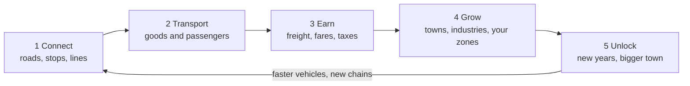

# Epochen der Wege – Game Design Document

## Vision and key facts

A peaceful 3D transport and city-building game: you found a settlement in antiquity
and build a transport network across a large region up to the modern age. Towns and
industries grow when you connect them, and you earn your money by moving goods and
people.

The game belongs to the genre of transport simulations and borrows city-building
mechanics such as zoning and demand. It has its own world, names, models and look.

| Aspect | Decision |
| --- | --- |
| Platform | macOS, Swift, Xcode |
| Presentation | 3D, freely rotating camera, look between model railway and strategy map |
| Time | Real time with pause and fast-forward (1×, 2×, 4×) |
| Conflict | No military, no war; competition is economic only |
| Role | Transport company and founder of one town: lines and roads everywhere, zones in your own town |
| Map | One region of 8 × 8 km (1024 × 1024 cells of 8 m) with 6 to 10 towns |
| Unlocks | The calendar year unlocks vehicles, road types and technologies; the size of your town unlocks city buildings |
| Starting era | 500 BC, through the Middle Ages and the industrial age to the modern age |
| Residents | Every resident has a home, a workplace and shopping trips; a sample of about 1 in 5–10 is visible on its way |

**Design pillars** – every decision is measured against these three:

1. **Everything flows visibly.** Every good and every commuter is an object on a path. No invisible storage.
2. **Logistics is the puzzle.** The challenge is not *what* to build but *how to connect* it.
3. **Eras build on each other.** Old paths remain, get upgraded or replaced; the landscape tells the story of the game.
4. **Roads first.** Every building stands on a road, towns grow along their roads, and people and goods move on the network.

## Core loop and progression

**Role of the player**

- You found one town and plan it with zones, like in a city builder. Towns build houses, markets and processing businesses in their zones on their own when there is demand.
- Across the region you are a transport company: you build roads, stops and lines and buy vehicles.
- Raw material industries and 6–10 neighbouring towns are already on the map. They grow when you connect them and shrink when you do not.
- Money comes mostly from transport: freight per unit and kilometre and fares per passenger and kilometre, plus the taxes of your own town.

**Unlocks**

| By | Unlocks | Example |
| --- | --- | --- |
| Calendar year | Vehicles, road types, stops, technologies, production chains | Ox cart from 500 BC, horse wagon from AD 600, steam train from 1830 |
| Size of your town | City buildings and house tiers | Village (40): weaver; small town (100): wine press, townhouses |

**Progression**

1. **Antiquity (500 BC – AD 500):** a hamlet with farmers, gravel roads, ox carts, barges; first neighbouring towns and quarries connected.
2. **Middle Ages (500 – 1500):** paved roads, horse wagons and coaches, iron and tools, canals.
3. **Industrial age (1750 – 1900):** railway, coal and steel, factories, trams.
4. **Modern age (1900 –):** asphalt, trucks and buses, electricity.

**Time model**

- The simulation runs in fixed ticks: 10 ticks per second at 1×
- 1 day = 2 seconds at 1×; the length of a year is set in the game data
- Fast-forward 2× and 4× only shortens the wait between ticks; the rules stay the same
- Pause allows building and planning without time pressure

## World and map

The map is a procedurally generated height field of 8 × 8 km with mountains, plains, coast and rivers; the terrain decides where building pays off and how expensive routes become.

**Structure**

- 1024 × 1024 cells of 8 m; rendering in tiles with several detail levels
- Biomes: water, sand, grassland, forest, rock, snow
- Deposits placed by the generator: stone, vines; later ore, coal, clay, oil
- 6–10 neutral towns of different sizes and specialisations, spread over the map
- A seed generates the map; the same seed always produces the same world

**Roads**

- Every building needs a road on one of its sides and faces it
- Roads form a graph of junctions and segments; people, carriers and vehicles find their way on it
- Road types: dirt track and gravel road (antiquity), paved road (Middle Ages), asphalt (modern); each with speed, capacity and upkeep; upgrades in place
- Steep cells become tunnels; later bridges

**Terrain rules**

- Buildings cannot be placed on slopes above 35 %
- Later: terraforming for money

## Population and settlements

Residents are simulated as a group per house; they grow and get promoted when their needs are met within reach, and shrink when they are not.

**Social tiers and needs** (each tier also needs the goods of the tier before)

| Tier | From era | Residents per house | Needs | Provides |
| --- | --- | --- | --- | --- |
| Farmers | Antiquity | 4 | Food (bread or fish), water | Work in raw material production |
| Citizens | Antiquity | 6 | + clothing, wine, market in reach | Crafts, taxes |
| Craftsmen | Middle Ages | 8 | + tools, furniture, church or temple | Workshops, some research |
| Workers | Industrial | 12 | + coal for heating, meat, public transport | Factories |
| Engineers | Industrial | 10 | + education, newspaper, consumer goods | Research, administration |
| Employees | Modern | 14 | + electricity, cars or public transport, leisure | Services, high taxes |

**Supply rule**

- Every house checks its supply every 10 days: share of needs met, 0 to 100 %
- Below 50 %: the house loses residents; 50 to 90 %: stable; above 90 % for 2 years: promotion to the next tier, if unlocked
- Goods count as "in reach" when a market, shop or station has them in stock and the house is within its radius (market 300 m, shop 200 m)

**People on the move**

- Every resident has a home, a workplace and places to shop, and makes these trips every day
- Short trips are walked along the roads; longer ones use a passenger line if one connects the stops; otherwise the trip does not happen and the house is less satisfied
- A building with 50 % of its workers produces at 50 % efficiency
- About 1 in 5–10 residents is visible as a figure on the way; figures wait at stops and board vehicles

**Towns**

- The map starts with 6 to 10 neutral towns (100 to 1,500 residents) and the player's starting hamlet
- Every town has zones and demand like the player's town and grows along its roads when supplied and connected
- The player's town grows through zones: demand bars show what it needs; houses, markets and businesses appear by themselves
- Settlement levels by population: hamlet, village, small town, town, city

## Production and goods

Every production building turns inputs into outputs in a fixed cycle; chains get longer with each era, and all values live in JSON files so they can be balanced without code changes.

**Building rules**

- A building has input stock, output stock (20 units each), required workers and a cycle time
- Full output stock = standstill. Empty input stock = standstill
- Goods leave a building only via a connected stop or a path to a storehouse
- Storehouses (200 units) buffer goods and act as transfer points between modes of transport

**Production chains (starting values, cycle in days)**

| Era | Building | Input | Output | Cycle | Workers |
| --- | --- | --- | --- | --- | --- |
| Antiquity | Woodcutter | – | 1 wood | 2 | 4 farmers |
| Antiquity | Quarry | – | 1 stone | 3 | 6 farmers |
| Antiquity | Grain farm | – | 2 grain | 4 | 6 farmers |
| Antiquity | Mill | 2 grain | 2 flour | 2 | 2 farmers |
| Antiquity | Bakery | 2 flour | 3 bread | 2 | 3 citizens |
| Antiquity | Fisher's hut | – | 2 fish | 3 | 3 farmers |
| Antiquity | Sheep farm + weaver | wool | 1 clothing | 4 | 4 farmers, 3 citizens |
| Antiquity | Vineyard | – | 1 wine | 6 | 5 farmers |
| Middle Ages | Ore mine + charcoal burner | wood | ore, charcoal | 3 | 8 farmers |
| Middle Ages | Smelter | 2 ore, 1 charcoal | 1 iron | 3 | 4 craftsmen |
| Middle Ages | Smithy | 1 iron, 1 wood | 2 tools | 3 | 3 craftsmen |
| Middle Ages | Joinery | 2 wood | 1 furniture | 3 | 3 craftsmen |
| Industrial | Coal mine | – | 3 coal | 2 | 12 workers |
| Industrial | Steelworks | 2 ore, 2 coal | 2 steel | 2 | 20 workers |
| Industrial | Machine factory | 2 steel, 1 tools | 1 machines | 4 | 20 workers, 4 engineers |
| Industrial | Slaughterhouse | 2 livestock | 3 meat | 2 | 8 workers |
| Modern | Refinery | 3 oil | 2 fuel, 1 plastic | 2 | 15 workers |
| Modern | Power plant | 2 coal or fuel | electricity in the grid | 1 | 10 workers |
| Modern | Consumer goods factory | 1 plastic, 1 steel | 2 consumer goods | 3 | 25 employees |

**Perishable goods**

- Fish, meat, milk and bread have a shelf life (fish 5, meat 8, bread 10 days)
- Expired goods disappear from storage and vehicles
- This makes fast transport and short routes worthwhile even when slow ones are cheaper

**Construction materials**

- Buildings cost money and materials (wood, stone, later bricks, steel, concrete)
- Materials must be delivered to the construction site; the site is a regular target in the logistics network

## Transport and logistics

The player builds routes and sets up lines; vehicles run the lines, load at stops and earn income per unit and kilometre.

**Networks**

| Network | From era | Cost per km | Notes |
| --- | --- | --- | --- |
| Footpath | Antiquity | 0 (emerges through use) | carriers only, slow |
| Gravel road | Antiquity | 2,000 | carts and wagons |
| Paved road | Middle Ages | 6,000 | +30 % speed, less wear |
| Waterway (river, canal) | Antiquity / Middle Ages | canal 25,000 | large volumes, slow |
| Railway | Industrial | 40,000 | slopes are critical, very high capacity |
| Asphalt road | Modern | 15,000 | trucks, buses, cars |
| Electrified railway | Modern | +20,000 on rail | faster, stronger locomotives |

**Vehicles (starting values)**

| Vehicle | Era | Capacity | Speed km/h | Price | Upkeep per year | Lifetime years |
| --- | --- | --- | --- | --- | --- | --- |
| Carrier | Antiquity | 1 | 4 | 50 | 20 | 20 |
| Ox cart | Antiquity | 4 | 5 | 400 | 80 | 20 |
| River barge | Antiquity | 20 | 6 | 1,500 | 200 | 30 |
| Horse wagon | Middle Ages | 8 | 10 | 1,200 | 200 | 20 |
| Stagecoach | Middle Ages | 8 passengers | 12 | 1,500 | 250 | 20 |
| Sailing ship | Middle Ages | 60 | 10 | 8,000 | 800 | 35 |
| Steam locomotive + freight wagons | Industrial | 30 per wagon | 40 | 30,000 | 3,000 | 30 |
| Horse tram | Industrial | 30 passengers | 12 | 5,000 | 600 | 25 |
| Truck | Modern | 15 | 60 | 20,000 | 2,500 | 15 |
| Bus | Modern | 50 passengers | 60 | 25,000 | 3,000 | 15 |
| Electric locomotive + freight wagons | Modern | 50 per wagon | 100 | 120,000 | 8,000 | 35 |

**Lines**

- A line is an ordered list of stops plus assigned vehicles
- Per stop: load, unload, wait until full (with a maximum waiting time)
- Vehicles only take goods whose destination is on the line or reachable via transfers
- People and goods choose their route by travel time; overcrowded lines lose passengers to the next best route

**Stops**

- Market place (antiquity), harbour, station, bus stop, logistics yard
- Catchment radius for goods and people; a station with 4 tracks serves many more vehicles than one with 2
- Stops have capacity; overcrowded stops form visible queues

**Ageing**

- From 75 % of the lifetime, upkeep rises by 50 % and vehicles break down briefly more often
- Replace with one click: the old vehicle is sold at residual value, a successor model takes over the line

## Eras

Eras follow the calendar. A new era unlocks everything at once, but old technology remains usable.

| Era | Years | Unlocks |
| --- | --- | --- |
| Antiquity | 500 BC – AD 500 | Carriers, ox carts, barges, gravel roads, basic chains, farmers and citizens |
| Middle Ages | 500 – 1500 | Horse wagons, coaches, paved roads, iron and tools, canals, sailing ships, craftsmen |
| Industrial age | 1750 – 1900 | Railway, coal, steel, factories, trams, workers and engineers |
| Modern age | 1900 – | Trucks, buses, asphalt, electricity, oil, employees |

**Vehicles age**

- Every vehicle has a lifetime; from 75 % of it upkeep rises by 50 % and breakdowns become more frequent
- Replace with one click: the old vehicle is sold at residual value, the newest model takes over the line

**Infrastructure upgrades**

- Existing routes can be upgraded without demolition (gravel → paved → asphalt); cost = difference plus 20 %

## Economy and finances

One currency (thalers) for everything; money comes from taxes, transport and trade and goes to construction, upkeep and vehicles.

**Income**

- Freight: base price of the good × kilometres × speed bonus (faster than expected = up to +50 %)
- Fares: per passenger and kilometre
- Taxes per resident and year in the player's town: hut 1, house 2, townhouse 4, later tiers more; only when supplied above 50 %
- Trade: towns pay a premium for goods they want

**Expenses**

- Construction: money plus materials (see production)
- Upkeep: buildings, routes and vehicles per year
- Buying vehicles

**Base prices per unit**

| Good | Price | Good | Price |
| --- | --- | --- | --- |
| Wood, stone, grain | 2 | Tools, furniture | 15 |
| Flour, fish, wool | 4 | Coal, ore | 5 |
| Bread, clothing | 8 | Steel | 20 |
| Wine | 10 | Machines | 60 |
| Iron | 12 | Consumer goods | 40 |

**Starting capital and loans**

- Start: 10,000 thalers (normal), 25,000 (easy), 5,000 (hard)
- Loans in steps of 5,000 thalers, 5 % interest per year, repayable at any time
- Bankruptcy when the balance stays below the credit limit for 2 years (competitive mode only)

## Later: rivals

Peaceful AI transport companies that compete for towns and routes are planned after the core game is complete (milestone *Later*): influence areas, trade contracts, rights of way and joint projects, never weapons.

## Goals and game modes

Three modes share the same rules and differ only in goals and opponents.

| Mode | Opponents | Goal | End |
| --- | --- | --- | --- |
| Free play | optional 0–3 AI | none; milestones as rewards | never |
| Scenario | predefined | fixed task, e.g. "Supply 3 towns with bread by year 40" | task done or deadline missed |
| Competition | 1–3 AI | be the first to finish a wonder, or have the highest prosperity at the end | wonder finished or year 300 |

**Wonders** (one per era; each needs large amounts of specific goods delivered to a construction site)

- Antiquity: lighthouse – 5,000 stone, 2,000 wood
- Middle Ages: cathedral – 8,000 stone, 2,000 tools, 1,000 wine
- Industrial: world's fair – 3,000 steel, 1,000 machines
- Modern: grand central station – 5,000 steel, 3,000 consumer goods, rail connection to every town

**Prosperity** = residents × average tier + value of the transport network + balance / 100

## Open questions

- [ ] Art style: low-poly with clear colours (faster to build) or more realistic?
- [ ] Seasons affecting harvests and shipping (frozen rivers)?
- [ ] Endless play: what happens after the modern age?
- [ ] Final name of the game

## Roadmap

| Milestone | Content |
| --- | --- |
| 0.3 Foundation for a large world | Save and load, 8 × 8 km map, terrain detail levels, spatial index, road graph, performance budget |
| 0.4 Roads & Towns | Road frontage for every building, towns grow along roads, 6–10 towns, road types, carriers on roads |
| 0.5 People on the Move | Residents' trips, visible pedestrians, passenger lines and fares, traffic |
| 0.6 Eras | Calendar from 500 BC, unlocks by year, vehicle ageing |
| 0.7 Economy | Industries on the map, freight income by distance, city services and land value, construction materials, perishable goods |
| Later | Railway, waterways, curved roads, terraforming, rivals |

Details and progress live in the [GitHub milestones](https://github.com/502Proxy/EpochenDerWege/milestones).
